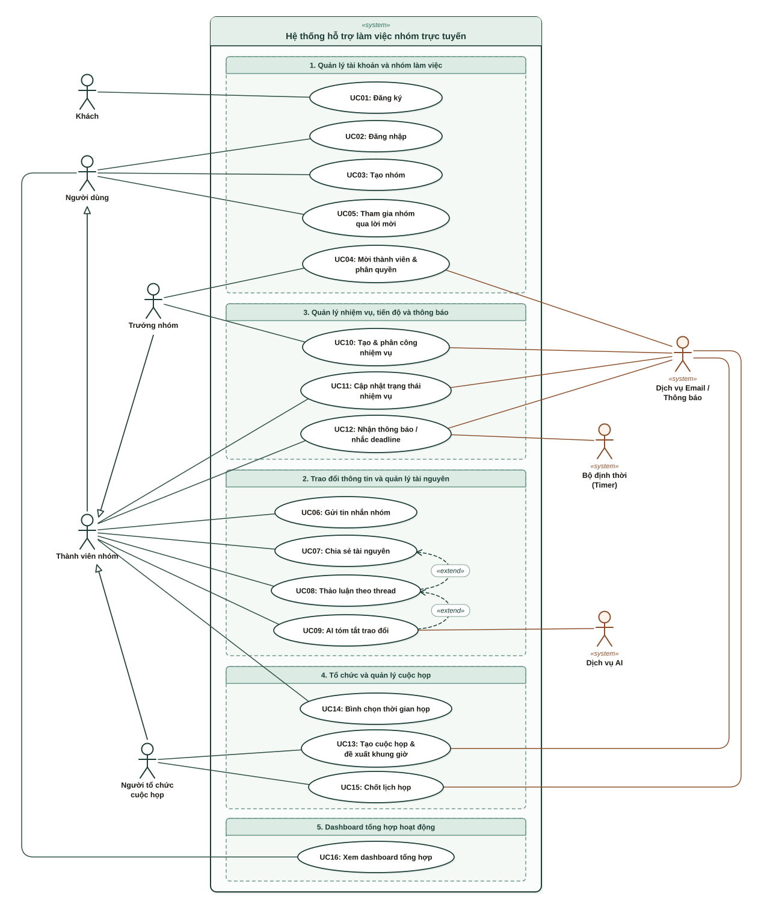
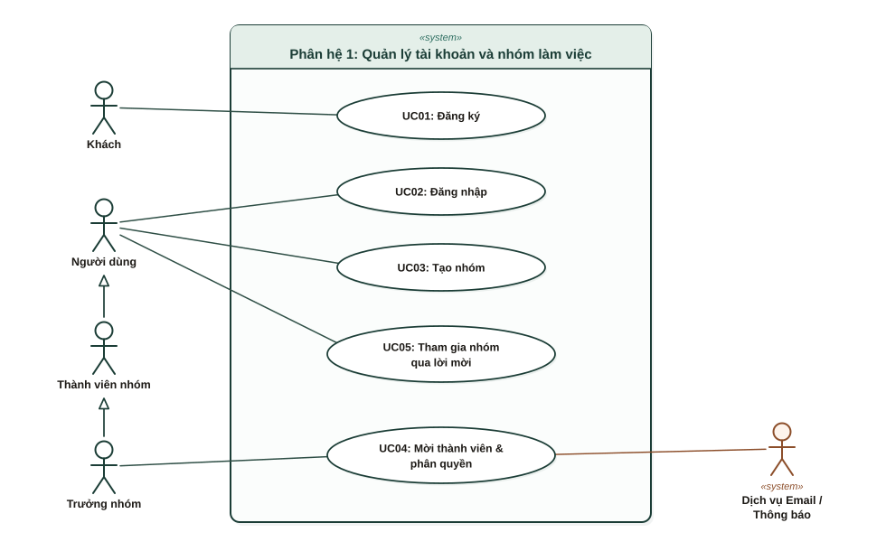
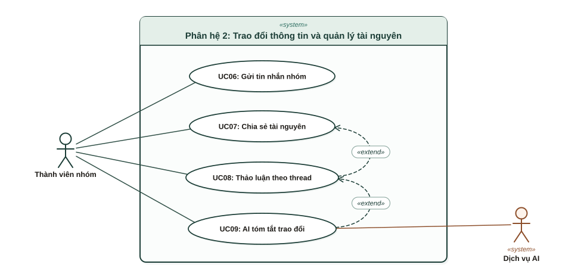
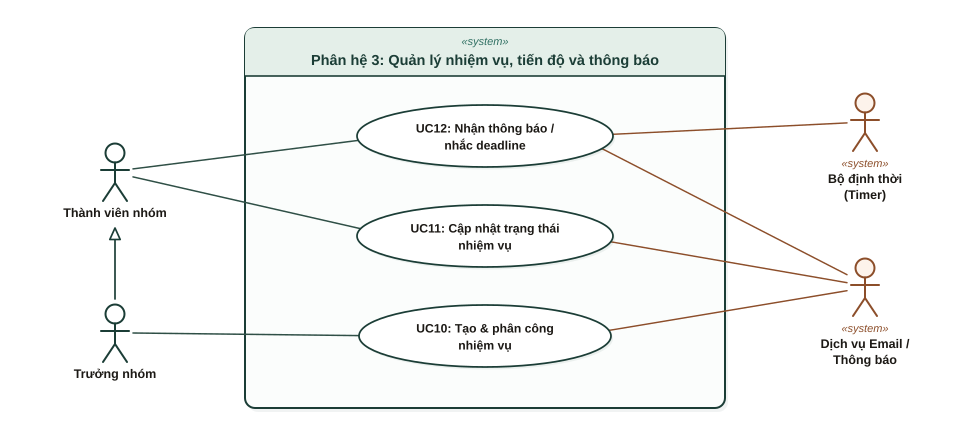
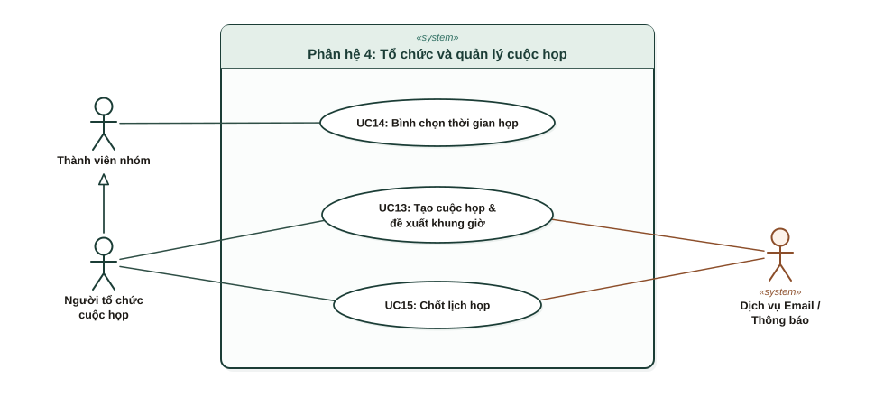
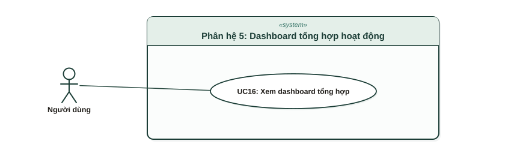

# ANALYSIS REPORT

**Môn học:** Nhập môn Công nghệ phần mềm  
**Đơn vị:** Bộ môn Công nghệ phần mềm – Khoa Công nghệ thông tin, Đại học Khoa học tự nhiên TP. HCM

## MỤC LỤC

- [1. Bảng đánh giá thành viên](#muc-1)
- [2. Mô tả bài toán](#muc-2)
  - [2.1. Bối cảnh và vấn đề cần giải quyết](#muc-2-1)
  - [2.2. Mục tiêu và phạm vi hệ thống](#muc-2-2)
  - [2.3. Mô tả nghiệp vụ](#muc-2-3)
  - [2.4. Môi trường hoạt động](#muc-2-4)
  - [2.5. Ràng buộc về thiết kế và triển khai](#muc-2-5)
- [3. Tổng quan yêu cầu](#muc-3)
  - [3.1. Danh sách các Stakeholder](#muc-3-1)
  - [3.2. Danh sách yêu cầu](#muc-3-2)
- [4. Đặc tả yêu cầu](#muc-4)
  - [4.1. Sơ đồ Use Case](#muc-4-1)
  - [4.2. Đặc tả Use Case](#muc-4-2)
- [5. Bản mẫu (Prototype)](#muc-5)

---

## 1. Bảng đánh giá thành viên

| MSSV | Họ Tên | % đóng góp (tối đa 100%) | Chữ ký |
| --- | --- | --- | --- |
| 24120377 | Hồ Văn Lý | 100 |  |
| 24120428 | Đặng Quang Sang | 100 |  |
| 24120413 | Võ Gia Phúc | 100 |  |
| 24120429 | Phạm Quang Sang | 100 |  |

## 2. Mô tả bài toán

### 2.1. Bối cảnh và vấn đề cần giải quyết

Trong học tập và làm việc, làm việc nhóm là hoạt động phổ biến, đặc biệt ở các bài tập, đồ án và dự án quy mô nhỏ. Một cá nhân thường tham gia đồng thời nhiều nhóm, mỗi nhóm có thành viên, tài liệu, công việc và lịch họp riêng. Hiện nay các nhóm thường phải ghép nhiều ứng dụng rời rạc: Messenger/Zalo để nhắn tin, Google Drive để lưu tài liệu, Google Meet để họp và một công cụ khác để quản lý công việc.

Cách làm này gây ra các vấn đề sau:

- **Thông tin phân tán:** tài liệu, thông báo và quyết định quan trọng nằm rải rác ở nhiều nơi, dễ bị trôi trong lịch sử tin nhắn nên thành viên mất thời gian tìm kiếm và tổng hợp lại.
- **Thông báo dễ bị bỏ sót:** ứng dụng nhắn tin thông thường lẫn cả giao tiếp cá nhân, nên thông báo liên quan đến công việc khó được chú ý.
- **Khó quản lý công việc:** việc phân công nhiệm vụ, theo dõi thời hạn và tiến độ không được quản lý tập trung.
- **Khó thống nhất lịch họp:** mỗi thành viên có lịch trình riêng, việc chọn thời gian họp bằng cách hỏi lần lượt trong tin nhắn tốn thời gian và thiếu căn cứ.
- **Khó quản lý nhiều nhóm:** người tham gia nhiều nhóm không có cái nhìn tổng hợp về việc cần làm và lịch họp sắp tới.

### 2.2. Mục tiêu và phạm vi hệ thống

**Hệ thống hỗ trợ làm việc nhóm trực tuyến** cung cấp một môi trường cộng tác thống nhất, cho phép người dùng trao đổi thông tin, quản lý tài nguyên, phân công công việc và tổ chức cuộc họp trên cùng một nền tảng. Hệ thống hướng đến các nhóm sinh viên thực hiện bài tập, đồ án và các nhóm dự án quy mô nhỏ, đồng thời hỗ trợ người dùng tham gia và quản lý nhiều nhóm.

Phạm vi gồm năm nhóm chức năng: (1) quản lý tài khoản và nhóm làm việc; (2) trao đổi thông tin và quản lý tài nguyên (nhắn tin, tài nguyên, thread, AI tóm tắt); (3) quản lý nhiệm vụ và tiến độ (kèm thông báo); (4) tổ chức và quản lý cuộc họp; (5) dashboard tổng hợp hoạt động.

**Ngoài phạm vi:** hệ thống không xây dựng chức năng gọi video riêng. Cuộc họp trực tuyến diễn ra trên nền tảng bên ngoài và hệ thống chỉ lưu, hiển thị liên kết tham gia.

### 2.3. Mô tả nghiệp vụ

**Tài khoản và nhóm.** Người dùng đăng ký tài khoản và đăng nhập trước khi dùng các chức năng làm việc nhóm. Sau khi đăng nhập, người dùng tạo nhóm mới hoặc tham gia nhóm đã tồn tại thông qua lời mời (lời mời có thể kèm thông báo qua email). Mỗi nhóm là một không gian làm việc độc lập gồm thành viên, nội dung trao đổi, tài nguyên, nhiệm vụ và lịch họp. Người tạo nhóm (trưởng nhóm) quản lý thông tin nhóm, mời hoặc loại bỏ thành viên và phân quyền. Một người dùng có thể thuộc nhiều nhóm và chuyển đổi giữa các không gian làm việc.

**Trao đổi, tài nguyên và thread.** Thành viên nhắn tin trong nhóm, đồng thời tải lên, lưu trữ và chia sẻ tài liệu, hình ảnh, tệp tin. Để nội dung thảo luận không bị lẫn trong cuộc trò chuyện chung, hệ thống cho phép tạo luồng thảo luận (thread) gắn trực tiếp với một tài nguyên hoặc một nhiệm vụ. Ví dụ, khi có người chia sẻ bản thiết kế giao diện, các thành viên góp ý ngay trong thread của tài liệu đó. Với các cuộc trao đổi dài, thành viên có thể yêu cầu AI tóm tắt nội dung chính. AI chỉ xử lý nội dung mà người yêu cầu có quyền truy cập, và bản tóm tắt chỉ mang tính hỗ trợ nên cần được đối chiếu với nội dung gốc.

**Nhiệm vụ và thông báo.** Người dùng có quyền phù hợp tạo nhiệm vụ, mô tả nội dung, phân công người phụ trách trong cùng nhóm và đặt thời hạn. Người được giao cập nhật trạng thái thực hiện để cả nhóm theo dõi tiến độ. Vấn đề phát sinh được trao đổi ở thread của nhiệm vụ. Hệ thống gửi thông báo đến người liên quan qua trình duyệt/thiết bị hoặc email khi có nhiệm vụ mới được giao, có thay đổi quan trọng hoặc nhiệm vụ sắp đến hạn.

**Cuộc họp.** Người tổ chức tạo cuộc họp, ghi nội dung, chọn thành viên tham gia và đề xuất nhiều khung giờ dự kiến. Các thành viên chọn khung giờ mình có thể tham dự. Hệ thống tổng hợp bình chọn và đề xuất các khung giờ có nhiều người tham dự được nhất. Kết quả bình chọn chỉ mang tính đề xuất: người tổ chức xác nhận thời gian chính thức, sau đó hệ thống thông báo cho các thành viên liên quan. Cuộc họp được lưu vào lịch của nhóm và có thể đính kèm liên kết đến nền tảng họp trực tuyến bên ngoài.

**Dashboard.** Với người tham gia nhiều nhóm, hệ thống cung cấp bảng điều khiển tổng hợp nhiệm vụ được giao, thời hạn sắp tới và lịch họp sắp diễn ra. Người dùng có thể xem theo từng nhóm hoặc xem tổng hợp. Dashboard chỉ hiển thị dữ liệu của các nhóm mà người dùng có quyền truy cập.

**Các quy tắc xuyên suốt.** Mọi tin nhắn, tài nguyên, nhiệm vụ và cuộc họp đều thuộc về một nhóm xác định. Dữ liệu giữa các nhóm được tách biệt và người dùng chỉ truy cập được nhóm mình là thành viên hoặc được cấp quyền. Các thao tác quản trị (quản lý thành viên, phân công nhiệm vụ, thay đổi thông tin quan trọng của nhóm) tuân theo quyền hạn tương ứng. Thread tuân theo quyền truy cập của tài nguyên hoặc nhiệm vụ mà nó gắn vào. Các quy tắc này tương ứng với QĐ01–QĐ09 trong Project Proposal.

**Các tình huống ngoại lệ cần xử lý:** thành viên thao tác khi không có quyền, người ngoài nhóm cố truy cập dữ liệu nhóm, tệp tải lên không hợp lệ, trùng lịch họp, và lỗi từ dịch vụ bên ngoài (gửi email thất bại, dịch vụ AI không phản hồi). Khi có lỗi, hệ thống phải thông báo rõ ràng cho người dùng.

### 2.4. Môi trường hoạt động

- **Nền tảng:** ứng dụng web theo kiến trúc Client–Server. Người dùng truy cập bằng trình duyệt hiện đại hỗ trợ HTML5, CSS3 và JavaScript, trên máy tính hoặc thiết bị di động có kết nối Internet. Giao diện cần dùng được trên nhiều kích thước màn hình.
- **Phía máy chủ:** dữ liệu được quản lý tập trung trên máy chủ để người dùng đăng nhập từ nhiều thiết bị vẫn thấy dữ liệu nhất quán. Cấu hình tham khảo cho giai đoạn thử nghiệm: Linux Server, 2 vCPU, 4 GB RAM, SSD từ 40 GB, kết nối ổn định và hỗ trợ HTTPS.
- **Giao tiếp Client–Server:** dùng RESTful API cho các thao tác thông thường; tin nhắn và thông báo cập nhật gần thời gian thực qua kết nối WebSocket (giao thức STOMP).
- **Dịch vụ bên ngoài:** dịch vụ AI (tóm tắt), dịch vụ email, dịch vụ thông báo trên trình duyệt/thiết bị, dịch vụ lưu trữ tệp và nền tảng họp trực tuyến (qua liên kết).

### 2.5. Ràng buộc về thiết kế và triển khai

- **Công nghệ:** Hệ thống sử dụng Next.js kết hợp TypeScript và Tailwind CSS để phát triển giao diện người dùng. Backend được xây dựng bằng Java và Spring Boot, sử dụng RESTful API làm phương thức giao tiếp chính giữa Client và Server. Cơ sở dữ liệu sử dụng PostgreSQL, kết hợp Spring Data JPA và Hibernate để quản lý và truy xuất dữ liệu. Spring WebSocket kết hợp STOMP hỗ trợ cập nhật tin nhắn và thông báo gần thời gian thực. Tệp tải lên được lưu trữ bằng Cloudflare R2 Object Storage thông qua giao thức tương thích Amazon S3, trong khi cơ sở dữ liệu lưu trữ thông tin mô tả và mã tham chiếu đến tệp. Backend chịu trách nhiệm kiểm tra quyền truy cập đối với các thao tác tải lên, tải xuống và quản lý tệp. Phương án triển khai cụ thể sẽ được xác định ở giai đoạn thiết kế theo yêu cầu và điều kiện dự án.
- **Phân tách thành phần:** giao diện, xử lý nghiệp vụ và lưu trữ dữ liệu được tách biệt. Việc xác thực và kiểm tra quyền truy cập phải thực hiện ở Backend cho mọi thao tác đọc/ghi.
- **Bảo mật và an toàn dữ liệu:** có xác thực tài khoản, phân quyền theo nhóm, bảo vệ dữ liệu; khóa truy cập các dịch vụ AI, email, thông báo và lưu trữ tệp phải được cấu hình an toàn, không đưa vào mã nguồn.
- **Quy trình và tài liệu:** áp dụng mô hình Waterfall, các tài liệu theo chuẩn môn học (SRS, Use Case, UML, ERD, đặc tả API).
- **Thời gian, nhân lực và chi phí:** thực hiện trong 8 tuần bởi nhóm 4 thành viên (tổng 256 giờ công), ngân sách dự kiến 1.200.000 VNĐ, ưu tiên công cụ mã nguồn mở và dịch vụ có hạn mức miễn phí.

## 3. Tổng quan yêu cầu

### 3.1. Danh sách các stakeholder

Stakeholder gồm những người dùng hệ thống, những bên phát triển/vận hành/đánh giá, và các hệ thống bên ngoài mà phần mềm giao tiếp. Hình dưới là Context Diagram thể hiện các bên tương tác với hệ thống, sau đó là bảng mô tả vai trò từng stakeholder.

| STT | Stakeholder                                       | Mô tả                                                                                                                                                                                                                                                                                                                                                                                                                                      |
| --- | ------------------------------------------------- | ------------------------------------------------------------------------------------------------------------------------------------------------------------------------------------------------------------------------------------------------------------------------------------------------------------------------------------------------------------------------------------------------------------------------------------------ |
| 1   | Người dùng chưa có tài khoản                      | Người truy cập hệ thống nhưng chưa đăng nhập, bao gồm người nhận lời mời vào nhóm. Chỉ được đăng ký và đăng nhập (QĐ01). Mong muốn đăng ký đơn giản và vào được nhóm nhanh khi có lời mời. Liên quan nhóm chức năng 1.                                                                                                                                                                                                                     |
| 2   | Thành viên nhóm                                   | Người dùng đã đăng nhập, thuộc một hoặc nhiều nhóm; là đối tượng sử dụng chính. Nhắn tin, tải và xem tài nguyên, thảo luận trong thread, yêu cầu AI tóm tắt, cập nhật trạng thái nhiệm vụ được giao, bình chọn giờ họp, nhận thông báo và xem dashboard. Mong muốn thông tin tập trung, dễ tìm, không bỏ sót việc và dùng được trên cả điện thoại. Chỉ truy cập dữ liệu của nhóm mình tham gia (QĐ02, QĐ04). Liên quan nhóm chức năng 1–5. |
| 3   | Trưởng nhóm (người tạo nhóm / người quản lý nhóm) | Thành viên tạo nhóm hoặc được cấp quyền quản trị. Có mọi quyền của thành viên và thêm quyền thay đổi thông tin nhóm, mời hoặc loại bỏ thành viên, phân quyền, tạo nhiệm vụ, phân công người thực hiện và đặt thời hạn (QĐ03, QĐ05). Mong muốn nhóm hoạt động có tổ chức, nắm được tiến độ chung và kiểm soát quyền truy cập. Liên quan nhóm chức năng 1, 3.                                                                                |
| 4   | Người tổ chức cuộc họp                            | Vai trò do thành viên có quyền phù hợp đảm nhận (thường là trưởng nhóm). Tạo cuộc họp, đề xuất các khung giờ, xem kết quả bình chọn, xác nhận thời gian chính thức và đính kèm liên kết họp (QĐ07). Mong muốn thống nhất lịch nhanh dựa trên số người tham dự được. Liên quan nhóm chức năng 4.                                                                                                                                            |
| 5   | Nhóm phát triển và vận hành hệ thống              | Nhóm 4 sinh viên thực hiện dự án, chịu trách nhiệm phân tích, thiết kế, cài đặt, kiểm thử, triển khai và bảo trì. Quan tâm đến yêu cầu rõ ràng, khả năng bảo trì và mở rộng, an toàn dữ liệu (phân quyền, khóa dịch vụ, sao lưu và khôi phục), và việc hoàn thành đúng hạn trong ngân sách.                                                                                                                                                |
| 6   | Giảng viên / Bộ môn Công nghệ phần mềm            | Hướng dẫn và đánh giá dự án. Quan tâm đến mức độ đầy đủ, nhất quán của các tài liệu theo từng giai đoạn và việc nhóm áp dụng đúng quy trình phát triển phần mềm.                                                                                                                                                                                                                                                                           |
| 7   | AI Service (hệ thống bên ngoài)                   | Dịch vụ AI nhận nội dung trao đổi và trả về bản tóm tắt. Hệ thống chỉ gửi nội dung mà người yêu cầu có quyền truy cập (QĐ09) và phải xử lý được trường hợp dịch vụ không phản hồi hoặc trả kết quả không chính xác. Liên quan nhóm chức năng 2.                                                                                                                                                                                            |
| 8   | Email Service (hệ thống bên ngoài)                | Dịch vụ gửi email lời mời vào nhóm và thông báo về nhiệm vụ, lịch họp. Hệ thống phải xử lý được trường hợp gửi email thất bại. Liên quan nhóm chức năng 1, 3, 4.                                                                                                                                                                                                                                                                           |
| 9   | Notification Service (hệ thống bên ngoài)         | Dịch vụ đẩy thông báo đến trình duyệt hoặc thiết bị của người dùng khi có nhiệm vụ mới, thay đổi quan trọng hoặc sắp đến hạn. Chỉ hoạt động khi người dùng cho phép nhận thông báo. Liên quan nhóm chức năng 3, 4.                                                                                                                                                                                                                         |
| 10  | Nền tảng họp trực tuyến (hệ thống bên ngoài)      | Dịch vụ họp (ví dụ Google Meet) mà thành viên truy cập qua liên kết đính kèm trong cuộc họp. Hệ thống chỉ lưu và hiển thị liên kết, không tích hợp gọi video. Liên quan nhóm chức năng 4.                                                                                                                                                                                                                                                  |
| 11  | File Storage Service (hệ thống bên ngoài)         | Dịch vụ lưu trữ đối tượng (dự kiến Cloudflare R2, giao tiếp theo chuẩn tương thích Amazon S3) chứa các tệp, hình ảnh, tài liệu do thành viên tải lên. Cơ sở dữ liệu chỉ lưu thông tin mô tả và mã tham chiếu đến tệp. Backend kiểm tra quyền truy cập (QĐ04) trước khi cho phép tải lên, tải xuống và quản lý tệp; hệ thống phải xử lý được lỗi tải tệp lên hoặc dịch vụ không phản hồi. Liên quan nhóm chức năng 2.                                                                                                             |

### 3.2. Danh sách yêu cầu

Dựa trên phạm vi và các nghiệp vụ đã xác định, yêu cầu của Hệ thống hỗ trợ làm việc nhóm trực tuyến được phân thành hai loại: yêu cầu chức năng và yêu cầu phi chức năng.

Yêu cầu chức năng mô tả những khả năng và thao tác mà hệ thống cần cung cấp cho người dùng. Yêu cầu phi chức năng xác định các tiêu chí về bảo mật, tính nhất quán dữ liệu, khả năng sử dụng, độ tin cậy và những ràng buộc kỹ thuật trong quá trình phát triển hệ thống.

Các yêu cầu được đánh mã để thuận tiện cho việc quản lý, kiểm tra và đối chiếu với các tài liệu thiết kế, kiểm thử ở những giai đoạn tiếp theo.

#### 3.2.1. Đặc tả yêu cầu chức năng

Các yêu cầu chức năng được đánh mã FR-01 đến FR-24 (FR – Functional Requirement, nghĩa là yêu cầu chức năng) và phân theo năm nhóm chức năng của PA01. Cột Requirement thể hiện mã và tên yêu cầu; cột Details mô tả hành vi, điều kiện và kết quả cần có.

Các yêu cầu chức năng tuân thủ những quy định nghiệp vụ có liên quan trong PA01. Các quy định chung về xác thực và phân quyền được áp dụng xuyên suốt; những quy định đặc thù được tham chiếu tại yêu cầu tương ứng.

##### Nhóm 1. Quản lý tài khoản và nhóm làm việc

| **User Story**                                                                            | **Requirement**                    | **Details**                                                                                                                                                             |
|-------------------------------------------------------------------------------------------|------------------------------------|-------------------------------------------------------------------------------------------------------------------------------------------------------------------------|
| Là người dùng, tôi muốn đăng ký tài khoản để sử dụng hệ thống.                            | FR-01 – Đăng ký tài khoản          | Hệ thống phải cho phép tạo tài khoản bằng thông tin đăng ký hợp lệ; thông báo kết quả và từ chối thông tin không hợp lệ hoặc trùng lặp. (QĐ01)                          |
| Là người dùng, tôi muốn đăng nhập để truy cập không gian làm việc của mình.               | FR-02 – Đăng nhập và xác thực      | Hệ thống phải xác thực thông tin đăng nhập trước khi cho phép sử dụng chức năng làm việc nhóm; từ chối truy cập khi chưa xác thực. (QĐ01)                               |
| Là người dùng, tôi muốn xem và cập nhật thông tin cá nhân để quản lý tài khoản.           | FR-03 – Quản lý thông tin cá nhân  | Hệ thống phải cho phép người dùng đã đăng nhập xem, chỉnh sửa thông tin cá nhân được phép thay đổi và lưu lại dữ liệu hợp lệ.                                           |
| Là người dùng, tôi muốn tạo nhóm và tham gia nhiều nhóm để quản lý những dự án khác nhau. | FR-04 – Tạo và tham gia nhóm       | Hệ thống phải cho phép tạo nhóm mới, tham gia nhóm có lời mời hợp lệ và xem danh sách nhóm đã tham gia; mỗi nhóm có không gian dữ liệu riêng. (QĐ02)                    |
| Là trưởng nhóm, tôi muốn quản lý thành viên để duy trì tổ chức của nhóm.                  | FR-05 – Quản lý thành viên         | Hệ thống phải cho phép người có quyền gửi lời mời, xem danh sách thành viên và loại bỏ thành viên; kiểm tra quyền trước khi thực hiện. (QĐ03)                           |
| Là trưởng nhóm, tôi muốn quản lý thông tin và quyền truy cập để bảo vệ dữ liệu nhóm.      | FR-06 – Quản lý nhóm và phân quyền | Hệ thống phải cho phép người có quyền cập nhật thông tin nhóm, quản lý vai trò/quyền của thành viên; ngăn người không đủ quyền thực hiện thao tác quản trị. (QĐ03–QĐ04) |

##### Nhóm 2. Trao đổi thông tin và quản lý tài nguyên

| **User Story**                                                                                             | **Requirement**                       | **Details**                                                                                                                                                                                     |
|------------------------------------------------------------------------------------------------------------|---------------------------------------|-------------------------------------------------------------------------------------------------------------------------------------------------------------------------------------------------|
| Là thành viên, tôi muốn nhắn tin với những người trong nhóm để trao đổi công việc.                         | FR-07 – Nhắn tin nhóm                 | Hệ thống phải cho phép gửi, nhận và xem tin nhắn trong không gian nhóm; tin nhắn chỉ hiển thị cho người có quyền truy cập nhóm. (QĐ04)                                                          |
| Là thành viên, tôi muốn lưu trữ và chia sẻ tệp trong nhóm để cùng sử dụng tài nguyên.                      | FR-08 – Tải lên và chia sẻ tài nguyên | Hệ thống phải cho phép thành viên có quyền tải lên tài liệu, hình ảnh, tệp tin và xem danh sách tài nguyên của nhóm; kiểm tra tính hợp lệ của tệp và thông báo lỗi khi tải lên thất bại. (QĐ04) |
| Là thành viên, tôi muốn xem hoặc tải tài liệu đã chia sẻ để phục vụ công việc.                             | FR-09 – Truy cập tài nguyên           | Hệ thống phải cho phép xem thông tin và tải xuống tệp thuộc nhóm khi có quyền; Backend kiểm tra quyền trước thao tác truy cập tệp. (QĐ04)                                                       |
| Là thành viên, tôi muốn thảo luận ngay tại tài liệu hoặc nhiệm vụ để không làm phân tán nội dung trao đổi. | FR-10 – Thảo luận theo luồng (Thread) | Hệ thống phải cho phép tạo và xem luồng thảo luận gắn với một tài nguyên hoặc nhiệm vụ xác định; quyền truy cập thread tuân theo đối tượng liên kết. (QĐ06)                                     |
| Là thành viên, tôi muốn AI tóm tắt cuộc trao đổi dài để nhanh chóng nắm thông tin chính.                   | FR-11 – AI tóm tắt nội dung trao đổi  | Hệ thống phải cho phép người có quyền yêu cầu tóm tắt nội dung trao đổi được phép xem, hiển thị bản tóm tắt để tham khảo; thông báo khi dịch vụ AI không phản hồi. (QĐ09)                       |

##### Nhóm 3. Quản lý nhiệm vụ, tiến độ và thông báo

| **User Story**                                                                                 | **Requirement**                      | **Details**                                                                                                                                                                                                       |
|------------------------------------------------------------------------------------------------|--------------------------------------|-------------------------------------------------------------------------------------------------------------------------------------------------------------------------------------------------------------------|
| Là trưởng nhóm hoặc người có quyền, tôi muốn tạo nhiệm vụ để xác định công việc cần thực hiện. | FR-12 – Tạo nhiệm vụ                 | Hệ thống phải cho phép nhập tên, mô tả và thời hạn nhiệm vụ thuộc một nhóm; chỉ người có quyền mới được tạo hoặc chỉnh sửa thông tin theo phân quyền. (QĐ03–QĐ05)                                                 |
| Là người có quyền, tôi muốn giao nhiệm vụ cho thành viên để xác định trách nhiệm.              | FR-13 – Phân công nhiệm vụ           | Hệ thống phải cho phép chỉ định người phụ trách thuộc đúng nhóm; từ chối phân công cho người ngoài nhóm và ghi nhận kết quả phân công. (QĐ05)                                                                     |
| Là thành viên được giao việc, tôi muốn cập nhật trạng thái để báo cáo tiến độ.                 | FR-14 – Cập nhật trạng thái nhiệm vụ | Hệ thống phải cho phép người được giao cập nhật trạng thái thực hiện; hiển thị trạng thái mới cho người có quyền trong nhóm. (QĐ05)                                                                               |
| Là thành viên, tôi muốn theo dõi nhiệm vụ và thời hạn để chủ động làm việc.                    | FR-15 – Xem nhiệm vụ và tiến độ      | Hệ thống phải cho phép xem danh sách, nội dung, người phụ trách, trạng thái và thời hạn nhiệm vụ trong phạm vi nhóm được phép truy cập. (QĐ04–QĐ05)                                                               |
| Là thành viên, tôi muốn nhận thông báo công việc để không bỏ sót thay đổi quan trọng.          | FR-16 – Thông báo nhiệm vụ           | Hệ thống phải thông báo đến người liên quan khi được giao nhiệm vụ, có thay đổi quan trọng hoặc nhiệm vụ sắp đến hạn; hỗ trợ kênh trình duyệt/thiết bị hoặc email theo khả năng và quyền cho phép nhận thông báo. |

##### Nhóm 4. Tổ chức và quản lý cuộc họp

| **User Story**                                                                               | **Requirement**                            | **Details**                                                                                                                                                                              |
|----------------------------------------------------------------------------------------------|--------------------------------------------|------------------------------------------------------------------------------------------------------------------------------------------------------------------------------------------|
| Là người tổ chức, tôi muốn tạo cuộc họp để chuẩn bị nội dung và mời người tham gia.          | FR-17 – Tạo cuộc họp                       | Hệ thống phải cho phép người có quyền tạo cuộc họp thuộc nhóm, nhập nội dung và lựa chọn thành viên liên quan; kiểm tra quyền truy cập và tính hợp lệ của thông tin.                     |
| Là người tổ chức, tôi muốn đề xuất nhiều khung giờ để tìm lịch họp phù hợp.                  | FR-18 – Đề xuất thời gian họp              | Hệ thống phải cho phép thêm các khung giờ dự kiến cho một cuộc họp để thành viên lựa chọn.                                                                                               |
| Là thành viên được mời, tôi muốn chọn khung giờ có thể tham dự để nhóm dễ thống nhất lịch.   | FR-19 – Bình chọn thời gian họp            | Hệ thống phải cho phép thành viên liên quan chọn những khung giờ có thể tham dự; ghi nhận lựa chọn theo từng cuộc họp.                                                                   |
| Là người tổ chức, tôi muốn xem kết quả bình chọn để quyết định lịch họp.                     | FR-20 – Tổng hợp và đề xuất khung giờ      | Hệ thống phải tổng hợp số người có thể tham dự theo từng khung giờ và gợi ý khung giờ có số người phù hợp cao nhất; kết quả chỉ mang tính đề xuất. (QĐ07)                                |
| Là người tổ chức, tôi muốn xác nhận giờ họp và gửi thông tin để mọi người tham dự đúng lịch. | FR-21 – Xác nhận và thông báo lịch họp     | Hệ thống phải bảo đảm chỉ người tổ chức có quyền được chốt thời gian chính thức; lưu lịch vào nhóm và gửi thông báo đến thành viên liên quan. (QĐ07)                                     |
| Là thành viên, tôi muốn xem lịch họp và liên kết tham gia để sắp xếp thời gian.              | FR-22 – Xem lịch họp và liên kết bên ngoài | Hệ thống phải cho phép xem lịch, nội dung và liên kết họp của các cuộc họp có quyền truy cập; hệ thống chỉ lưu/hiển thị liên kết nền tảng họp ngoài, không tự cung cấp gọi video. (QĐ04) |

##### Nhóm 5. Dashboard tổng hợp hoạt động

| **User Story**                                                                             | **Requirement**                    | **Details**                                                                                                                                   |
|--------------------------------------------------------------------------------------------|------------------------------------|-----------------------------------------------------------------------------------------------------------------------------------------------|
| Là người dùng tham gia nhiều nhóm, tôi muốn xem công việc và cuộc họp sắp tới tại một nơi. | FR-23 – Dashboard cá nhân tổng hợp | Hệ thống phải hiển thị nhiệm vụ được giao, thời hạn sắp tới và lịch họp sắp diễn ra từ các nhóm mà người dùng có quyền truy cập. (QĐ08)       |
| Là người dùng, tôi muốn xem thông tin theo từng nhóm để tập trung vào một dự án.           | FR-24 – Lọc Dashboard theo nhóm    | Hệ thống phải cho phép chuyển giữa chế độ tổng hợp và chế độ xem theo nhóm; không hiển thị dữ liệu ngoài phạm vi quyền truy cập. (QĐ02, QĐ08) |

#### 3.2.2. Đặc tả yêu cầu phi chức năng

Các yêu cầu phi chức năng được đánh mã NFR-01 đến NFR-12 (NFR – Non-Functional Requirement, nghĩa là yêu cầu phi chức năng), tập trung vào an toàn dữ liệu, chất lượng vận hành và ràng buộc thiết kế đã nêu trong PA01 và PA02.

| **Mã** | **Nhóm yêu cầu**                | **Nội dung yêu cầu**                                                                                                                                                                                                                | **Cơ sở đối chiếu**                        |
|--------|---------------------------------|-------------------------------------------------------------------------------------------------------------------------------------------------------------------------------------------------------------------------------------|--------------------------------------------|
| NFR-01 | Bảo mật và xác thực             | Các chức năng làm việc nhóm yêu cầu người dùng đăng nhập; mọi API đọc/ghi dữ liệu nghiệp vụ phải kiểm tra xác thực ở Backend.                                                                                                       | QĐ01; PA02 mục 2.5                         |
| NFR-02 | Phân quyền và tách biệt dữ liệu | Backend phải kiểm tra quyền theo nhóm và vai trò trước khi đọc/ghi dữ liệu; không trả dữ liệu của nhóm mà người dùng không có quyền.                                                                                                | QĐ02–QĐ04, QĐ06–QĐ09                       |
| NFR-03 | An toàn truy cập tệp            | Chỉ cho phép tải lên, tải xuống, quản lý tệp sau khi xác thực và kiểm tra quyền; tệp lưu trên R2, CSDL lưu thông tin mô tả và mã tham chiếu, không dùng đường dẫn công khai làm cơ chế phân quyền.                                  | PA02 mục 2.5; QĐ04                         |
| NFR-04 | Bảo vệ thông tin tích hợp       | Khóa truy cập AI, email, dịch vụ thông báo và lưu trữ tệp phải được cấu hình an toàn; không nhúng trực tiếp vào mã nguồn phía Client.                                                                                               | PA02 mục 2.5                               |
| NFR-05 | Tính nhất quán dữ liệu          | Dữ liệu tài khoản, nhóm, quyền thành viên, nhiệm vụ, bình chọn và lịch họp phải được lưu nhất quán, cập nhật để người dùng truy cập từ nhiều thiết bị có thể xem thông tin mới.                                                     | PA01 mục 3.1.2; PA02 mục 2.4               |
| NFR-06 | Cập nhật gần thời gian thực     | Tin nhắn và thông báo được truyền gần thời gian thực qua WebSocket/STOMP khi kết nối sẵn có; sự cố kết nối không được làm sai lệch dữ liệu đã lưu.                                                                                  | PA02 mục 2.4–2.5                           |
| NFR-07 | Khả năng tương thích            | Ứng dụng hoạt động trên các trình duyệt hiện đại hỗ trợ HTML5, CSS3, JavaScript; giao diện phù hợp màn hình máy tính và thiết bị di động.                                                                                           | PA02 mục 2.4                               |
| NFR-08 | Khả năng sử dụng                | Giao diện phải thể hiện rõ nhóm đang làm việc, trạng thái nhiệm vụ, thời hạn và lịch họp; khi thao tác thành công hoặc thất bại phải có phản hồi dễ hiểu.                                                                           | PA02 mục 2.1–2.3                           |
| NFR-09 | Xử lý lỗi và độ tin cậy         | Khi dữ liệu đầu vào không hợp lệ, không có quyền, tệp lỗi, lịch họp trùng hoặc dịch vụ ngoài không phản hồi, hệ thống phải báo lỗi rõ ràng và không ghi nhận kết quả thành công sai.                                                | PA02 mục 2.3                               |
| NFR-10 | Tính sẵn sàng của dữ liệu       | Dữ liệu nghiệp vụ được quản lý tập trung; việc triển khai phải có phương án sao lưu và khôi phục phù hợp với môi trường vận hành của dự án.                                                                                         | PA02 mục 2.4; stakeholder vận hành mục 3.1 |
| NFR-11 | Khả năng bảo trì và mở rộng     | Tách biệt Frontend, Backend và lưu trữ dữ liệu; API và các thành phần nghiệp vụ được tổ chức để dễ kiểm thử, chỉnh sửa và mở rộng tính năng.                                                                                        | PA01 mục 3.1.2; PA02 mục 2.5               |
| NFR-12 | Ràng buộc công nghệ             | Frontend: Next.js, TypeScript, Tailwind CSS; Backend: Java, Spring Boot, RESTful API; CSDL: PostgreSQL với Spring Data JPA/Hibernate; truyền thời gian thực: Spring WebSocket/STOMP; lưu tệp: Cloudflare R2 qua API tương thích S3. | PA02 mục 2.5                               |

**Lưu ý về phạm vi:** Hệ thống chỉ lưu và hiển thị liên kết họp bên ngoài, không xây dựng gọi video. Các chỉ tiêu định lượng về tải, thời gian phản hồi và mức độ sẵn sàng chưa được PA01/PA02 ấn định; sẽ được thống nhất ở giai đoạn thiết kế và kiểm thử.

## 4. ĐẶC TẢ YÊU CẦU

### 4.1. Sơ đồ Use Case

#### 4.1.1. Xác định các Tác nhân (Actors)

| STT | Tên tác nhân | Phân loại | Kế thừa từ | Mô tả vai trò trong hệ thống |
| --- | --- | --- | --- | --- |
| 1 | **Khách** *(Guest)* | Tác nhân chính | — | Người dùng chưa có tài khoản; thực hiện đăng ký tài khoản mới để sử dụng hệ thống (`QĐ01`). |
| 2 | **Người dùng** *(User)* | Tác nhân chính | — | Cá nhân đã có tài khoản; có thể đăng nhập, quản lý thông tin cá nhân, tạo nhóm mới, tham gia nhóm qua lời mời và xem/lọc Dashboard tổng hợp (`QĐ01`, `QĐ02`, `QĐ08`). |
| 3 | **Thành viên nhóm** *(Group Member)* | Tác nhân chính | Người dùng | Người dùng thuộc một nhóm xác định (`QĐ04`); thực hiện nhắn tin, chia sẻ/truy cập tài nguyên, thảo luận theo thread (`QĐ06`), dùng AI tóm tắt trao đổi (`QĐ09`), xem/cập nhật trạng thái nhiệm vụ (`QĐ05`), nhận thông báo và bình chọn/xem lịch họp. |
| 4 | **Trưởng nhóm** *(Group Leader)* | Tác nhân chính | Thành viên nhóm | Người quản trị nhóm (`QĐ03`); có quyền mời/loại bỏ thành viên, cập nhật thông tin nhóm, phân quyền thành viên và tạo/phân công nhiệm vụ (`QĐ03`–`QĐ05`). |
| 5 | **Người tổ chức cuộc họp** *(Meeting Organizer)* | Tác nhân chính | Thành viên nhóm | Thành viên có quyền tạo cuộc họp, đề xuất khung giờ, xem kết quả tổng hợp bình chọn và chốt lịch họp chính thức (`QĐ07`). |
| 6 | **Dịch vụ AI** *(AI Service)* | Tác nhân phụ (`«system»`) | — | Dịch vụ bên ngoài được Backend gọi để tóm tắt nội dung trao đổi trong phạm vi người dùng có quyền xem (`QĐ09`, `NFR-04`). |
| 7 | **Dịch vụ Email / Thông báo** *(Email & Notification Service)* | Tác nhân phụ (`«system»`) | — | Dịch vụ hỗ trợ gửi email và thông báo trình duyệt/thiết bị đối với lời mời nhóm, nhiệm vụ và lịch họp (`NFR-04`). |
| 8 | **Bộ định thời** *(Timer)* | Tác nhân hệ thống (`«system»`) | — | Tiến trình tự động kiểm tra định kỳ các nhiệm vụ sắp đến hạn để kích hoạt thông báo nhắc việc. |

------------------------------------------------------------------------

#### 4.1.2. Tổng hợp danh sách các Use Case theo phân hệ

| Mã UC | Tên Use Case | Phân hệ chức năng | Tác nhân chính | Tác nhân phụ / Hệ thống | Đối chiếu Mục 3.2 |
| --- | --- | --- | --- | --- | --- |
| **UC01** | Đăng ký | 1. Quản lý tài khoản và nhóm làm việc | Khách | — | `FR-01`; `QĐ01`; `NFR-01`, `NFR-09` |
| **UC02** | Đăng nhập | 1. Quản lý tài khoản và nhóm làm việc | Người dùng | — | `FR-02`, `FR-03`; `QĐ01`; `NFR-01`, `NFR-05` |
| **UC03** | Tạo nhóm | 1. Quản lý tài khoản và nhóm làm việc | Người dùng | — | `FR-04`; `QĐ02`, `QĐ03`; `NFR-02`, `NFR-05` |
| **UC04** | Mời thành viên & phân quyền | 1. Quản lý tài khoản và nhóm làm việc | Trưởng nhóm | Dịch vụ Email / Thông báo | `FR-05`, `FR-06`; `QĐ03`, `QĐ04`; `NFR-02`, `NFR-04` |
| **UC05** | Tham gia nhóm qua lời mời | 1. Quản lý tài khoản và nhóm làm việc | Người dùng | — | `FR-04`; `QĐ02`, `QĐ04`; `NFR-02`, `NFR-05` |
| **UC06** | Gửi tin nhắn nhóm | 2. Trao đổi thông tin và quản lý tài nguyên | Thành viên nhóm | — | `FR-07`; `QĐ04`; `NFR-02`, `NFR-06` |
| **UC07** | Chia sẻ tài nguyên | 2. Trao đổi thông tin và quản lý tài nguyên | Thành viên nhóm | — | `FR-08`, `FR-09`; `QĐ04`; `NFR-03`, `NFR-04` |
| **UC08** | Thảo luận theo thread | 2. Trao đổi thông tin và quản lý tài nguyên | Thành viên nhóm | — | `FR-10`; `QĐ04`, `QĐ06`; `NFR-02`, `NFR-06` |
| **UC09** | AI tóm tắt trao đổi | 2. Trao đổi thông tin và quản lý tài nguyên | Thành viên nhóm | Dịch vụ AI | `FR-11`; `QĐ04`, `QĐ09`; `NFR-02`, `NFR-04`, `NFR-09` |
| **UC10** | Tạo & phân công nhiệm vụ | 3. Quản lý nhiệm vụ, tiến độ và thông báo | Trưởng nhóm | Dịch vụ Email / Thông báo | `FR-12`, `FR-13`; `QĐ03`–`QĐ05`; `NFR-02`, `NFR-05` |
| **UC11** | Cập nhật trạng thái nhiệm vụ | 3. Quản lý nhiệm vụ, tiến độ và thông báo | Thành viên nhóm | Dịch vụ Email / Thông báo | `FR-14`, `FR-15`; `QĐ04`, `QĐ05`; `NFR-02`, `NFR-05` |
| **UC12** | Nhận thông báo / nhắc deadline | 3. Quản lý nhiệm vụ, tiến độ và thông báo | Thành viên nhóm | Bộ định thời, Dịch vụ Email / Thông báo | `FR-16`; `QĐ04`, `QĐ05`; `NFR-04`, `NFR-06` |
| **UC13** | Tạo cuộc họp & đề xuất khung giờ | 4. Tổ chức và quản lý cuộc họp | Người tổ chức cuộc họp | Dịch vụ Email / Thông báo | `FR-17`, `FR-18`; `QĐ04`; `NFR-02`, `NFR-05` |
| **UC14** | Bình chọn thời gian họp | 4. Tổ chức và quản lý cuộc họp | Thành viên nhóm | — | `FR-19`, `FR-20`; `QĐ04`, `QĐ07`; `NFR-02`, `NFR-05` |
| **UC15** | Chốt lịch họp | 4. Tổ chức và quản lý cuộc họp | Người tổ chức cuộc họp | Dịch vụ Email / Thông báo | `FR-20`–`FR-22`; `QĐ04`, `QĐ07`; `NFR-02`, `NFR-05` |
| **UC16** | Xem dashboard tổng hợp | 5. Dashboard tổng hợp hoạt động | Người dùng | — | `FR-23`, `FR-24`; `QĐ02`, `QĐ08`; `NFR-02`, `NFR-08` |

------------------------------------------------------------------------

#### 4.1.3. Sơ đồ Use Case Tổng quát của Hệ thống

*Ghi chú mô hình:* - **Kế thừa tác nhân (`--|>`):** *Thành viên nhóm* kế thừa *Người dùng*; *Trưởng nhóm* và *Người tổ chức cuộc họp* kế thừa *Thành viên nhóm*. - **Quan hệ mở rộng (`«extend»`):** `UC08` mở rộng `UC07` (thảo luận trực tiếp trên tài nguyên chia sẻ); `UC09` mở rộng `UC08` (AI tóm tắt luồng thảo luận dài). Ngoài ra `UC08` và `UC09` cũng có thể được kích hoạt trực tiếp từ nhiệm vụ hoặc kênh nhắn tin nhóm.

------------------------------------------------------------------------

#### 4.1.4. Sơ đồ Use Case phân rã theo từng nhóm chức năng

##### a) Phân hệ 1: Quản lý tài khoản và nhóm làm việc (`UC01` – `UC05`)

##### b) Phân hệ 2: Trao đổi thông tin và quản lý tài nguyên (`UC06` – `UC09`)

##### c) Phân hệ 3: Quản lý nhiệm vụ, tiến độ và thông báo (`UC10` – `UC12`)

##### d) Phân hệ 4: Tổ chức và quản lý cuộc họp (`UC13` – `UC15`)

##### e) Phân hệ 5: Dashboard tổng hợp hoạt động (`UC16`)

------------------------------------------------------------------------

### 4.2. Đặc tả Use Case

#### Nhóm 1. Quản lý tài khoản và nhóm làm việc

##### Đặc tả Use Case 1 — UC01: Đăng ký

| Thuộc tính | Nội dung |
| --- | --- |
| **Use case ID** | UC01 |
| **Tên Use Case** | Đăng ký |
| **Tóm tắt** | Cho phép khách tạo tài khoản mới bằng thông tin đăng ký hợp lệ (`FR-01`, `QĐ01`). |
| **Tác nhân** | Khách |
| **Điều kiện tiên quyết** | Khách chưa đăng nhập và đang mở trang Đăng ký. |
| **Kết quả** | Tài khoản mới được lưu vào CSDL (mật khẩu đã băm) và chuyển sang màn hình Đăng nhập; nếu thất bại thì giữ nguyên dữ liệu và báo lỗi. |
| **Kịch bản chính** | 1. Khách chọn chức năng **"Đăng ký tài khoản"**. 2. Hệ thống hiển thị biểu mẫu (*Họ tên*, *Email*, *Mật khẩu*, *Xác nhận mật khẩu*). 3. Khách nhập thông tin và nhấn **"Đăng ký"**. 4. Hệ thống kiểm tra định dạng dữ liệu và kiểm tra Email chưa tồn tại trong CSDL. 5. Hệ thống băm mật khẩu, lưu tài khoản mới và thông báo đăng ký thành công. 6. Hệ thống chuyển hướng người dùng sang trang **Đăng nhập** (`UC02`). |
| **Kịch bản phụ** | - **4a. Thông tin không hợp lệ hoặc mật khẩu xác nhận không khớp:** Hệ thống báo lỗi tại trường tương ứng và yêu cầu nhập lại. - **4b. Email đã tồn tại:** Hệ thống từ chối tạo tài khoản và thông báo Email đã được sử dụng. |
| **Ràng buộc phi chức năng** | - Mật khẩu được băm an toàn trước khi lưu CSDL (`NFR-01`, `QĐ01`). - Giao diện tương thích trình duyệt máy tính, di động và báo lỗi rõ ràng khi dữ liệu không hợp lệ (`NFR-07`–`NFR-09`). |

------------------------------------------------------------------------

##### Đặc tả Use Case 2 — UC02: Đăng nhập

| Thuộc tính | Nội dung |
| --- | --- |
| **Use case ID** | UC02 |
| **Tên Use Case** | Đăng nhập |
| **Tóm tắt** | Xác thực thông tin đăng nhập để truy cập không gian làm việc nhóm và quản lý thông tin cá nhân (`FR-02`, `FR-03`, `QĐ01`). |
| **Tác nhân** | Người dùng |
| **Điều kiện tiên quyết** | Người dùng đã có tài khoản trên hệ thống. |
| **Kết quả** | Khởi tạo phiên làm việc hợp lệ, hiển thị danh sách nhóm tham gia và Dashboard; từ chối truy cập nếu chưa xác thực. |
| **Kịch bản chính** | 1. Người dùng mở màn hình **"Đăng nhập"**. 2. Hệ thống hiển thị biểu mẫu nhập *Email* và *Mật khẩu*. 3. Người dùng nhập thông tin và nhấn **"Đăng nhập"**. 4. Hệ thống kiểm tra dữ liệu và đối chiếu thông tin xác thực trong CSDL. 5. Hệ thống tạo phiên đăng nhập, tải danh sách nhóm đã tham gia và điều hướng vào **Dashboard tổng hợp** (`UC16`). |
| **Kịch bản phụ** | - **4a. Sai Email hoặc Mật khẩu:** Hệ thống từ chối truy cập và báo lỗi *"Email hoặc mật khẩu không chính xác"*. - **4b. Truy cập chức năng nhóm khi chưa đăng nhập:** Backend từ chối yêu cầu và chuyển về trang Đăng nhập (`QĐ01`). - **5a. Xem và cập nhật thông tin cá nhân (`FR-03`):** Sau khi đăng nhập, người dùng mở hồ sơ cá nhân, chỉnh sửa thông tin được phép thay đổi và lưu lại dữ liệu hợp lệ. |
| **Ràng buộc phi chức năng** | - Mọi API nghiệp vụ phải kiểm tra xác thực ở Backend (`NFR-01`). - Dữ liệu tài khoản đồng bộ nhất quán khi truy cập từ nhiều thiết bị (`NFR-05`, `NFR-08`). |

------------------------------------------------------------------------

##### Đặc tả Use Case 3 — UC03: Tạo nhóm

| Thuộc tính | Nội dung |
| --- | --- |
| **Use case ID** | UC03 |
| **Tên Use Case** | Tạo nhóm |
| **Tóm tắt** | Cho phép người dùng tạo nhóm làm việc mới với không gian dữ liệu riêng và nhận vai trò Trưởng nhóm (`FR-04`, `QĐ02`, `QĐ03`). |
| **Tác nhân** | Người dùng |
| **Điều kiện tiên quyết** | Người dùng đã đăng nhập (`QĐ01`). |
| **Kết quả** | Nhóm mới được tạo với không gian dữ liệu độc lập, người tạo là Trưởng nhóm và nhóm hiển thị trong danh sách nhóm đã tham gia. |
| **Kịch bản chính** | 1. Người dùng chọn **"Tạo nhóm mới"**. 2. Hệ thống hiển thị biểu mẫu nhập *Tên nhóm* và *Mô tả*. 3. Người dùng nhập thông tin và nhấn **"Tạo nhóm"**. 4. Hệ thống kiểm tra tính hợp lệ của thông tin nhóm. 5. Hệ thống tạo nhóm mới trong CSDL, khởi tạo không gian dữ liệu riêng và gán quyền **Trưởng nhóm** cho người tạo. 6. Hệ thống cập nhật danh sách nhóm đã tham gia và mở không gian nhóm vừa tạo. |
| **Kịch bản phụ** | - **3a. Hủy thao tác:** Hệ thống đóng biểu mẫu, không lưu dữ liệu. - **4a. Tên nhóm trống hoặc không hợp lệ:** Hệ thống báo lỗi và yêu cầu nhập lại. |
| **Ràng buộc phi chức năng** | - Tách biệt dữ liệu giữa các nhóm; một người dùng có thể tạo và tham gia nhiều nhóm (`NFR-02`, `QĐ02`). - Lưu trữ nhất quán thông tin nhóm và quyền Trưởng nhóm trong cùng một giao dịch CSDL (`NFR-05`, `NFR-09`). |

------------------------------------------------------------------------

##### Đặc tả Use Case 4 — UC04: Mời thành viên & phân quyền

| Thuộc tính | Nội dung |
| --- | --- |
| **Use case ID** | UC04 |
| **Tên Use Case** | Mời thành viên & phân quyền |
| **Tóm tắt** | Cho phép Trưởng nhóm mời/loại bỏ thành viên, cập nhật thông tin nhóm và quản lý vai trò/quyền truy cập trong nhóm (`FR-05`, `FR-06`, `QĐ03`, `QĐ04`). |
| **Tác nhân** | - **Tác nhân chính:** Trưởng nhóm - **Tác nhân phụ:** Dịch vụ Email / Thông báo |
| **Điều kiện tiên quyết** | Người thực hiện đã đăng nhập và có quyền Trưởng nhóm tại nhóm đang thao tác (`QĐ03`). |
| **Kết quả** | Lời mời được lưu và gửi đi; hoặc danh sách thành viên, quyền hạn và thông tin nhóm được cập nhật trong CSDL. |
| **Kịch bản chính** | 1. Trưởng nhóm mở mục **"Quản lý nhóm & Thành viên"**. 2. Hệ thống kiểm tra quyền và hiển thị danh sách thành viên kèm vai trò hiện tại. 3. Trưởng nhóm nhập *Email* người cần mời, chọn vai trò dự kiến và nhấn **"Gửi lời mời"**. 4. Hệ thống kiểm tra quyền Trưởng nhóm, định dạng Email và đảm bảo người nhận chưa ở trong nhóm. 5. Hệ thống lưu lời mời (trạng thái *Đang chờ*) vào CSDL. 6. Hệ thống gửi thông báo/email lời mời qua **Dịch vụ Email / Thông báo** và hiển thị kết quả thành công. |
| **Kịch bản phụ** | - **3a. Thay đổi vai trò/quyền thành viên (`FR-06`):** Trưởng nhóm cập nhật vai trò của thành viên; hệ thống kiểm tra quyền và lưu phân quyền mới. - **3b. Loại bỏ thành viên (`FR-05`):** Trưởng nhóm chọn xóa thành viên khỏi nhóm; hệ thống thu hồi quyền truy cập nhóm của người đó (`QĐ04`). - **3c. Cập nhật thông tin nhóm (`FR-06`):** Trưởng nhóm sửa tên/mô tả nhóm và lưu lại dữ liệu hợp lệ. - **4a. Người thực hiện không đủ quyền:** Backend từ chối thao tác quản trị và báo lỗi (`QĐ03`, `NFR-02`). |
| **Ràng buộc phi chức năng** | - Backend kiểm tra quyền quản trị trước mọi thao tác mời, xóa thành viên hoặc sửa nhóm/phân quyền (`NFR-01`, `NFR-02`). - Bảo mật khóa dịch vụ email/thông báo ở Backend và cập nhật quyền nhất quán (`NFR-04`, `NFR-05`). |

------------------------------------------------------------------------

##### Đặc tả Use Case 5 — UC05: Tham gia nhóm qua lời mời

| Thuộc tính | Nội dung |
| --- | --- |
| **Use case ID** | UC05 |
| **Tên Use Case** | Tham gia nhóm qua lời mời |
| **Tóm tắt** | Cho phép người dùng chấp nhận lời mời hợp lệ để gia nhập nhóm và truy cập không gian dữ liệu của nhóm (`FR-04`, `QĐ02`, `QĐ04`). |
| **Tác nhân** | Người dùng |
| **Điều kiện tiên quyết** | Người dùng đã đăng nhập (`QĐ01`) và có lời mời tham gia nhóm hợp lệ đang chờ. |
| **Kết quả** | Người dùng trở thành thành viên nhóm, nhóm xuất hiện trong danh sách nhóm đã tham gia. |
| **Kịch bản chính** | 1. Người dùng mở mục **"Lời mời tham gia nhóm"** (hoặc truy cập từ liên kết mời). 2. Hệ thống kiểm tra lời mời hợp lệ và khớp với tài khoản đang đăng nhập. 3. Hệ thống hiển thị thông tin nhóm được mời kèm nút **"Chấp nhận"** và **"Từ chối"**. 4. Người dùng chọn **"Chấp nhận"**. 5. Hệ thống thêm người dùng vào thành viên nhóm, cập nhật lời mời thành *Đã chấp nhận* và chuyển vào không gian nhóm. |
| **Kịch bản phụ** | - **2a. Lời mời hết hạn, đã thu hồi hoặc sai tài khoản:** Hệ thống từ chối và báo lỗi lời mời không hợp lệ. - **4a. Người dùng chọn "Từ chối":** Hệ thống cập nhật trạng thái *Đã từ chối* và kết thúc Use Case. |
| **Ràng buộc phi chức năng** | - Kiểm tra chặt chẽ quyền và tính hợp lệ của lời mời ở Backend trước khi cấp quyền vào nhóm (`NFR-01`, `NFR-02`). - Đồng bộ danh sách nhóm đã tham gia trên mọi thiết bị (`NFR-05`, `NFR-08`). |

------------------------------------------------------------------------

#### Nhóm 2. Trao đổi thông tin và quản lý tài nguyên

##### Đặc tả Use Case 6 — UC06: Gửi tin nhắn nhóm

| Thuộc tính | Nội dung |
| --- | --- |
| **Use case ID** | UC06 |
| **Tên Use Case** | Gửi tin nhắn nhóm |
| **Tóm tắt** | Cho phép thành viên gửi, nhận và xem tin nhắn trong không gian nhóm; chỉ hiển thị cho người có quyền truy cập nhóm (`FR-07`, `QĐ04`). |
| **Tác nhân** | Thành viên nhóm |
| **Điều kiện tiên quyết** | Người dùng đã đăng nhập và có quyền truy cập nhóm (`QĐ01`, `QĐ04`). |
| **Kết quả** | Tin nhắn được lưu vào CSDL và truyền gần thời gian thực đến các thành viên trong nhóm. |
| **Kịch bản chính** | 1. Thành viên mở kênh **"Nhắn tin nhóm"**. 2. Hệ thống kiểm tra quyền truy cập nhóm, tải lịch sử tin nhắn và kết nối `WebSocket/STOMP`. 3. Thành viên nhập nội dung tin nhắn và nhấn **"Gửi"**. 4. Hệ thống kiểm tra quyền thành viên ở Backend và tính hợp lệ của tin nhắn. 5. Hệ thống lưu tin nhắn vào CSDL và phát qua `WebSocket/STOMP` tới các thành viên có quyền trong nhóm. |
| **Kịch bản phụ** | - **4a. Tin nhắn rỗng hoặc người gửi mất quyền truy cập nhóm:** Hệ thống từ chối gửi và báo lỗi. - **5a. Gián đoạn kết nối `WebSocket/STOMP`:** Hệ thống báo lỗi gửi tin để thử lại và không làm sai lệch dữ liệu đã lưu (`NFR-06`). |
| **Ràng buộc phi chức năng** | - Kiểm tra quyền theo nhóm ở Backend; không trả tin nhắn cho người ngoài nhóm (`NFR-02`, `QĐ04`). - Truyền tin nhắn gần thời gian thực qua `Spring WebSocket/STOMP` (`NFR-06`, `NFR-12`). |

------------------------------------------------------------------------

##### Đặc tả Use Case 7 — UC07: Chia sẻ tài nguyên

| Thuộc tính | Nội dung |
| --- | --- |
| **Use case ID** | UC07 |
| **Tên Use Case** | Chia sẻ tài nguyên |
| **Tóm tắt** | Cho phép thành viên tải lên, xem danh sách và tải xuống tài liệu/tệp tin trong nhóm sau khi kiểm tra quyền (`FR-08`, `FR-09`, `QĐ04`). |
| **Tác nhân** | Thành viên nhóm |
| **Điều kiện tiên quyết** | Người dùng đã đăng nhập và có quyền truy cập nhóm (`QĐ01`, `QĐ04`). |
| **Kết quả** | Tệp được lưu trên Cloudflare R2, metadata và mã tham chiếu lưu trong PostgreSQL; thành viên có quyền xem và tải được tệp. |
| **Kịch bản chính** | 1. Thành viên mở mục **"Tài nguyên nhóm"** để xem danh sách tài nguyên hiện có (`FR-08`). 2. Thành viên chọn **"Tải lên tài nguyên"**, chọn tệp từ thiết bị, nhập mô tả và xác nhận. 3. Hệ thống kiểm tra quyền thành viên và kiểm tra tính hợp lệ của tệp (định dạng, dung lượng). 4. Hệ thống lưu tệp lên **Cloudflare R2** và lưu thông tin mô tả kèm mã tham chiếu vào CSDL. 5. Hệ thống cập nhật danh sách tài nguyên nhóm và thông báo thành công. |
| **Kịch bản phụ** | - **1a. Xem thông tin và tải xuống tệp (`FR-09`):** Thành viên chọn tài nguyên để xem hoặc tải xuống; Backend kiểm tra quyền trong nhóm trước khi cho phép truy cập tệp. - **3a. Tệp không hợp lệ hoặc tải lên thất bại:** Hệ thống hủy thao tác, không ghi nhận dữ liệu lỗi và thông báo rõ nguyên nhân (`NFR-09`). |
| **Ràng buộc phi chức năng** | - Tệp lưu trên **Cloudflare R2** (API tương thích S3), CSDL lưu thông tin mô tả và mã tham chiếu; không dùng đường dẫn công khai làm cơ chế phân quyền (`NFR-03`, `NFR-12`). - Khóa lưu trữ tệp cấu hình an toàn ở Backend, không nhúng ở Client (`NFR-04`). |

------------------------------------------------------------------------

##### Đặc tả Use Case 8 — UC08: Thảo luận theo thread

| Thuộc tính | Nội dung |
| --- | --- |
| **Use case ID** | UC08 |
| **Tên Use Case** | Thảo luận theo thread |
| **Tóm tắt** | Cho phép tạo và xem luồng thảo luận (Thread) gắn với một tài nguyên hoặc nhiệm vụ xác định trong nhóm (`FR-10`, `QĐ06`). |
| **Tác nhân** | Thành viên nhóm |
| **Điều kiện tiên quyết** | Người dùng đã đăng nhập, có quyền truy cập nhóm và đối tượng tài nguyên/nhiệm vụ liên kết (`QĐ04`, `QĐ06`). |
| **Kết quả** | Phản hồi mới được lưu vào đúng thread của tài nguyên/nhiệm vụ và hiển thị cho các thành viên có quyền. |
| **Kịch bản chính** | 1. Thành viên chọn một **Tài nguyên** hoặc **Nhiệm vụ** trong nhóm và mở mục **"Thảo luận (Thread)"**. 2. Hệ thống kiểm tra quyền truy cập đối tượng liên kết và hiển thị nội dung thảo luận của thread. 3. Thành viên nhập nội dung trao đổi và nhấn **"Gửi"**. 4. Hệ thống kiểm tra đối tượng liên kết hợp lệ, lưu phản hồi vào CSDL và cập nhật lên giao diện thread qua `WebSocket/STOMP`. |
| **Kịch bản phụ** | - **2a. Yêu cầu AI tóm tắt thread (`«extend»` sang `UC09`):** Thành viên chọn tóm tắt nội dung thread dài bằng AI. - **4a. Không có quyền hoặc đối tượng gốc đã bị xóa:** Hệ thống từ chối lưu phản hồi và thông báo lỗi. |
| **Ràng buộc phi chức năng** | - Quyền truy cập thread tuân thủ nghiêm ngặt quyền truy cập của tài nguyên/nhiệm vụ liên kết (`NFR-02`, `QĐ06`). - Lưu trữ nhất quán và cập nhật phản hồi gần thời gian thực (`NFR-05`, `NFR-06`). |

------------------------------------------------------------------------

##### Đặc tả Use Case 9 — UC09: AI tóm tắt trao đổi

| Thuộc tính | Nội dung |
| --- | --- |
| **Use case ID** | UC09 |
| **Tên Use Case** | AI tóm tắt trao đổi |
| **Tóm tắt** | Cho phép thành viên yêu cầu AI tóm tắt nội dung cuộc trao đổi được phép xem để tham khảo (`FR-11`, `QĐ09`). |
| **Tác nhân** | - **Tác nhân chính:** Thành viên nhóm - **Tác nhân phụ:** Dịch vụ AI |
| **Điều kiện tiên quyết** | Người dùng đã đăng nhập và có quyền xem kênh nhắn tin nhóm hoặc thread cần tóm tắt (`QĐ04`, `QĐ09`). |
| **Kết quả** | Hiển thị bản tóm tắt nội dung chính để tham khảo; thông báo rõ nếu dịch vụ AI không phản hồi. |
| **Kịch bản chính** | 1. Tại kênh tin nhắn nhóm hoặc thread, thành viên nhấn **"AI tóm tắt trao đổi"** và chọn phạm vi tin nhắn. 2. Hệ thống kiểm tra quyền xem của thành viên tại Backend và trích xuất các tin nhắn hợp lệ. 3. Backend gửi yêu cầu đến **Dịch vụ AI** để tổng hợp nội dung chính. 4. Hệ thống nhận kết quả và hiển thị bản tóm tắt kèm lưu ý nội dung chỉ mang tính tham khảo (`QĐ09`). |
| **Kịch bản phụ** | - **2a. Không có quyền xem cuộc trao đổi hoặc dữ liệu quá ngắn:** Hệ thống từ chối gọi AI và thông báo rõ. - **3a. Dịch vụ AI không phản hồi:** Hệ thống thông báo lỗi rõ ràng và không làm ảnh hưởng chức năng nhắn tin (`FR-11`, `NFR-09`). |
| **Ràng buộc phi chức năng** | - Chỉ tóm tắt dữ liệu trong phạm vi quyền xem của người yêu cầu (`NFR-02`, `QĐ09`). - Khóa truy cập AI được bảo mật tại Backend, không nhúng vào Client (`NFR-04`). |

------------------------------------------------------------------------

#### Nhóm 3. Quản lý nhiệm vụ, tiến độ và thông báo

##### Đặc tả Use Case 10 — UC10: Tạo & phân công nhiệm vụ

| Thuộc tính | Nội dung |
| --- | --- |
| **Use case ID** | UC10 |
| **Tên Use Case** | Tạo & phân công nhiệm vụ |
| **Tóm tắt** | Cho phép người có quyền tạo/chỉnh sửa nhiệm vụ và phân công cho thành viên thuộc đúng nhóm (`FR-12`, `FR-13`, `QĐ03`–`QĐ05`). |
| **Tác nhân** | - **Tác nhân chính:** Trưởng nhóm *(hoặc người có quyền theo phân quyền)* - **Tác nhân phụ:** Dịch vụ Email / Thông báo |
| **Điều kiện tiên quyết** | Người thực hiện đã đăng nhập và có quyền tạo/phân công nhiệm vụ trong nhóm (`QĐ03`, `QĐ04`). |
| **Kết quả** | Nhiệm vụ và kết quả phân công được lưu vào CSDL; thông báo nhiệm vụ được gửi cho người phụ trách. |
| **Kịch bản chính** | 1. Người có quyền mở mục **"Nhiệm vụ"** của nhóm và chọn **"Tạo nhiệm vụ"**. 2. Hệ thống hiển thị biểu mẫu (*Tên nhiệm vụ*, *Mô tả*, *Thời hạn*, *Người phụ trách trong nhóm*). 3. Người thực hiện nhập thông tin, chọn thành viên phụ trách và nhấn **"Lưu & Phân công"**. 4. Hệ thống kiểm tra quyền tạo nhiệm vụ, tính hợp lệ của thông tin và kiểm tra người được giao thuộc đúng nhóm (`QĐ05`). 5. Hệ thống lưu nhiệm vụ vào CSDL và gửi thông báo cho người được giao qua ứng dụng/email (`FR-16`). |
| **Kịch bản phụ** | - **3a. Chỉnh sửa nhiệm vụ hoặc phân công lại (`FR-12`, `FR-13`):** Người có quyền cập nhật thông tin hoặc người phụ trách thuộc nhóm; hệ thống kiểm tra quyền và lưu thay đổi. - **4a. Thiếu thông tin hoặc phân công cho người ngoài nhóm:** Backend từ chối và báo lỗi rõ ràng (`QĐ05`, `NFR-09`). |
| **Ràng buộc phi chức năng** | - Kiểm tra phân quyền tạo/sửa nhiệm vụ và ràng buộc thành viên thuộc nhóm ở Backend (`NFR-01`, `NFR-02`). - Dữ liệu nhiệm vụ đồng bộ nhất quán với bảng tiến độ nhóm và Dashboard (`NFR-05`, `NFR-08`). |

------------------------------------------------------------------------

##### Đặc tả Use Case 11 — UC11: Cập nhật trạng thái nhiệm vụ

| Thuộc tính | Nội dung |
| --- | --- |
| **Use case ID** | UC11 |
| **Tên Use Case** | Cập nhật trạng thái nhiệm vụ |
| **Tóm tắt** | Cho phép thành viên xem nhiệm vụ/tiến độ trong nhóm và cho phép người được giao cập nhật trạng thái thực hiện (`FR-14`, `FR-15`, `QĐ04`, `QĐ05`). |
| **Tác nhân** | - **Tác nhân chính:** Thành viên nhóm - **Tác nhân phụ:** Dịch vụ Email / Thông báo |
| **Điều kiện tiên quyết** | Người dùng đã đăng nhập, thuộc nhóm và là người được giao nhiệm vụ khi cập nhật trạng thái (`QĐ04`, `QĐ05`). |
| **Kết quả** | Trạng thái nhiệm vụ mới được lưu vào CSDL và hiển thị cho các thành viên có quyền trong nhóm. |
| **Kịch bản chính** | 1. Thành viên mở danh sách **"Nhiệm vụ"** của nhóm. 2. Hệ thống kiểm tra quyền và hiển thị danh sách, nội dung, người phụ trách, trạng thái và thời hạn nhiệm vụ (`FR-15`). 3. Người được giao chọn nhiệm vụ của mình, chọn trạng thái mới (*Cần làm* / *Đang thực hiện* / *Hoàn thành*) và nhấn **"Lưu"** (`FR-14`). 4. Hệ thống kiểm tra quyền cập nhật tại Backend (`QĐ05`), lưu trạng thái mới vào CSDL và cập nhật giao diện tiến độ của nhóm. |
| **Kịch bản phụ** | - **2a. Chỉ xem tiến độ (`FR-15`):** Thành viên xem thông tin và thời hạn các nhiệm vụ trong nhóm mà không đổi trạng thái. - **4a. Người thao tác không phải người được giao việc (và không có quyền quản lý):** Backend từ chối cập nhật và báo lỗi (`QĐ05`, `NFR-02`). |
| **Ràng buộc phi chức năng** | - Kiểm soát quyền xem và cập nhật trạng thái nhiệm vụ tại Backend (`NFR-02`, `QĐ04`, `QĐ05`). - Thể hiện rõ trạng thái nhiệm vụ, thời hạn trên giao diện và đồng bộ dữ liệu nhất quán (`NFR-05`, `NFR-08`). |

------------------------------------------------------------------------

##### Đặc tả Use Case 12 — UC12: Nhận thông báo / nhắc deadline

| Thuộc tính | Nội dung |
| --- | --- |
| **Use case ID** | UC12 |
| **Tên Use Case** | Nhận thông báo / nhắc deadline |
| **Tóm tắt** | Tự động gửi thông báo khi thành viên được giao việc, có thay đổi quan trọng hoặc nhiệm vụ sắp đến hạn (`FR-16`). |
| **Tác nhân** | - **Tác nhân chính:** Thành viên nhóm - **Tác nhân phụ / Hệ thống:** Bộ định thời (*Timer*), Dịch vụ Email / Thông báo |
| **Điều kiện tiên quyết** | Có sự kiện giao/thay đổi nhiệm vụ hoặc nhiệm vụ chưa hoàn thành sắp chạm mốc thời hạn; người nhận còn quyền trong nhóm (`QĐ04`). |
| **Kết quả** | Thông báo được lưu vào CSDL và gửi qua trình duyệt/thiết bị (`WebSocket/STOMP`) hoặc email cho người liên quan. |
| **Kịch bản chính** | 1. **Bộ định thời** phát hiện nhiệm vụ sắp đến hạn (hoặc hệ thống ghi nhận sự kiện giao/cập nhật nhiệm vụ). 2. Hệ thống kiểm tra quyền thành viên của người nhận trong nhóm và tạo bản ghi thông báo mới trong CSDL. 3. Hệ thống gửi thông báo qua `WebSocket/STOMP` trên trình duyệt/thiết bị và gửi email qua **Dịch vụ Email / Thông báo**. 4. Thành viên nhấn xem thông báo; hệ thống đánh dấu *Đã đọc* và mở chi tiết nhiệm vụ tương ứng. |
| **Kịch bản phụ** | - **1a. Nhiệm vụ đã hoàn thành trước thời điểm nhắc hạn:** Hệ thống bỏ qua, không tạo thông báo. - **3a. Thiết bị ngoại tuyến hoặc dịch vụ email lỗi:** Hệ thống vẫn giữ thông báo trong CSDL để người dùng xem khi truy cập ứng dụng (`NFR-06`, `NFR-09`). |
| **Ràng buộc phi chức năng** | - Truyền thông báo gần thời gian thực qua `WebSocket/STOMP` và bảo mật cấu hình dịch vụ thông báo (`NFR-04`, `NFR-06`). - Không gửi thông báo cho người không còn quyền trong nhóm (`NFR-02`, `QĐ04`). |

------------------------------------------------------------------------

#### Nhóm 4. Tổ chức và quản lý cuộc họp

##### Đặc tả Use Case 13 — UC13: Tạo cuộc họp & đề xuất khung giờ

| Thuộc tính | Nội dung |
| --- | --- |
| **Use case ID** | UC13 |
| **Tên Use Case** | Tạo cuộc họp & đề xuất khung giờ |
| **Tóm tắt** | Cho phép người tổ chức tạo cuộc họp trong nhóm, chọn thành viên liên quan và thêm các khung giờ dự kiến để bình chọn (`FR-17`, `FR-18`). |
| **Tác nhân** | - **Tác nhân chính:** Người tổ chức cuộc họp - **Tác nhân phụ:** Dịch vụ Email / Thông báo |
| **Điều kiện tiên quyết** | Người dùng đã đăng nhập và có quyền tạo cuộc họp trong nhóm (`QĐ01`, `QĐ04`). |
| **Kết quả** | Cuộc họp cùng các khung giờ đề xuất được lưu vào CSDL và thông báo mời bình chọn được gửi tới thành viên liên quan. |
| **Kịch bản chính** | 1. Người tổ chức mở mục **"Lịch họp"** của nhóm và chọn **"Tạo cuộc họp"**. 2. Hệ thống hiển thị biểu mẫu nhập *Tiêu đề*, *Nội dung*, *Thành viên tham dự*, *Liên kết họp dự kiến* và *Các khung giờ đề xuất*. 3. Người tổ chức nhập thông tin, thêm các khung giờ dự kiến và nhấn **"Tạo cuộc họp"**. 4. Hệ thống kiểm tra quyền truy cập và tính hợp lệ của thông tin/khung giờ. 5. Hệ thống lưu cuộc họp (trạng thái *Đang bình chọn*) vào CSDL và gửi thông báo cho các thành viên liên quan. |
| **Kịch bản phụ** | - **4a. Thông tin thiếu hoặc khung giờ không hợp lệ / trùng lịch:** Hệ thống báo lỗi rõ ràng và yêu cầu điều chỉnh (`NFR-09`). - **4b. Không có quyền trong nhóm:** Backend từ chối yêu cầu tạo cuộc họp (`NFR-02`). |
| **Ràng buộc phi chức năng** | - Kiểm tra quyền theo nhóm ở Backend trước khi tạo cuộc họp (`NFR-01`, `NFR-02`, `QĐ04`). - Dữ liệu cuộc họp và khung giờ đề xuất được lưu nhất quán (`NFR-05`, `NFR-08`). |

------------------------------------------------------------------------

##### Đặc tả Use Case 14 — UC14: Bình chọn thời gian họp

| Thuộc tính | Nội dung |
| --- | --- |
| **Use case ID** | UC14 |
| **Tên Use Case** | Bình chọn thời gian họp |
| **Tóm tắt** | Cho phép thành viên chọn các khung giờ có thể tham dự; hệ thống tổng hợp và gợi ý khung giờ phù hợp nhất (`FR-19`, `FR-20`, `QĐ07`). |
| **Tác nhân** | Thành viên nhóm |
| **Điều kiện tiên quyết** | Người dùng đã đăng nhập, thuộc cuộc họp của nhóm và cuộc họp đang mở bình chọn (`UC13`, `QĐ04`). |
| **Kết quả** | Lựa chọn của thành viên được lưu theo cuộc họp; hệ thống cập nhật số người tham dự được ở từng khung giờ và hiển thị khung giờ đề xuất. |
| **Kịch bản chính** | 1. Thành viên mở cuộc họp đang lấy ý kiến trong mục **"Lịch họp"**. 2. Hệ thống kiểm tra quyền truy cập và hiển thị các khung giờ dự kiến. 3. Thành viên chọn những khung giờ có thể tham dự và nhấn **"Gửi bình chọn"** (`FR-19`). 4. Hệ thống lưu lựa chọn của thành viên vào CSDL. 5. Hệ thống tổng hợp số người có thể tham dự theo từng khung giờ và đánh dấu gợi ý khung giờ có số người phù hợp cao nhất (`FR-20`, `QĐ07`). |
| **Kịch bản phụ** | - **3a. Thay đổi lựa chọn khi chưa chốt lịch:** Thành viên cập nhật lại khung giờ; hệ thống ghi đè lựa chọn cũ và tính lại kết quả tổng hợp. - **4a. Cuộc họp đã chốt lịch:** Hệ thống từ chối bình chọn mới và hiển thị lịch chính thức. |
| **Ràng buộc phi chức năng** | - Kết quả tổng hợp chỉ mang tính đề xuất, không tự động chốt lịch (`QĐ07`). - Lưu trữ nhất quán kết quả bình chọn giữa các thiết bị (`NFR-02`, `NFR-05`). |

------------------------------------------------------------------------

##### Đặc tả Use Case 15 — UC15: Chốt lịch họp

| Thuộc tính | Nội dung |
| --- | --- |
| **Use case ID** | UC15 |
| **Tên Use Case** | Chốt lịch họp |
| **Tóm tắt** | Cho phép người tổ chức xác nhận giờ họp chính thức, lưu liên kết họp bên ngoài và gửi thông báo cho nhóm; thành viên xem lịch và liên kết tham gia (`FR-20`–`FR-22`, `QĐ04`, `QĐ07`). |
| **Tác nhân** | - **Tác nhân chính:** Người tổ chức cuộc họp *(và Thành viên nhóm khi xem lịch họp)* - **Tác nhân phụ:** Dịch vụ Email / Thông báo |
| **Điều kiện tiên quyết** | Người dùng đã đăng nhập, thuộc nhóm; thao tác chốt lịch yêu cầu quyền Người tổ chức cuộc họp (`QĐ04`, `QĐ07`). |
| **Kết quả** | Lịch họp chính thức và liên kết họp bên ngoài được lưu vào nhóm, hiển thị trên Dashboard và thông báo tới thành viên liên quan. |
| **Kịch bản chính** | 1. Người tổ chức mở chi tiết cuộc họp để xem kết quả tổng hợp bình chọn và khung giờ được đề xuất (`FR-20`). 2. Người tổ chức chọn thời gian họp chính thức, nhập liên kết nền tảng họp bên ngoài (Google Meet, Zoom...) và nhấn **"Xác nhận lịch họp"** (`FR-21`). 3. Hệ thống kiểm tra quyền Người tổ chức (`QĐ07`), tính hợp lệ của liên kết và kiểm tra trùng lịch. 4. Hệ thống đóng bình chọn, lưu lịch họp chính thức vào CSDL của nhóm. 5. Hệ thống gửi thông báo lịch họp đến các thành viên liên quan qua ứng dụng và **Dịch vụ Email / Thông báo**. |
| **Kịch bản phụ** | - **5a. Thành viên xem lịch họp và liên kết bên ngoài (`FR-22`):** Thành viên có quyền mở lịch họp nhóm để xem nội dung, thời gian và nhấn vào liên kết nền tảng họp bên ngoài. - **3a. Người thao tác không phải Người tổ chức có quyền hoặc trùng lịch:** Hệ thống từ chối/cảnh báo lỗi rõ ràng (`QĐ07`, `NFR-02`, `NFR-09`). |
| **Ràng buộc phi chức năng** | - Bảo đảm chỉ Người tổ chức có quyền mới được chốt lịch chính thức (`NFR-02`, `QĐ07`). - Hệ thống chỉ lưu và hiển thị liên kết nền tảng họp ngoài, không tự cung cấp gọi video (`FR-22`, `NFR-05`, `NFR-08`). |

------------------------------------------------------------------------

#### Nhóm 5. Dashboard tổng hợp hoạt động

##### Đặc tả Use Case 16 — UC16: Xem dashboard tổng hợp

| Thuộc tính | Nội dung |
| --- | --- |
| **Use case ID** | UC16 |
| **Tên Use Case** | Xem dashboard tổng hợp |
| **Tóm tắt** | Hiển thị tổng hợp nhiệm vụ được giao, thời hạn sắp tới và lịch họp sắp diễn ra từ các nhóm có quyền truy cập; hỗ trợ lọc theo từng nhóm (`FR-23`, `FR-24`, `QĐ02`, `QĐ08`). |
| **Tác nhân** | Người dùng |
| **Điều kiện tiên quyết** | Người dùng đã đăng nhập (`QĐ01`). |
| **Kết quả** | Hiển thị đúng dữ liệu nhiệm vụ, deadline và lịch họp trong phạm vi các nhóm mà người dùng có quyền truy cập. |
| **Kịch bản chính** | 1. Người dùng mở màn hình **"Dashboard"**. 2. Hệ thống kiểm tra xác thực và lấy danh sách các nhóm người dùng có quyền truy cập (`QĐ08`). 3. Ở chế độ tổng hợp (`FR-23`), hệ thống hiển thị các nhiệm vụ được giao, thời hạn sắp tới và lịch họp sắp diễn ra từ tất cả các nhóm đó. 4. Người dùng chọn lọc theo một nhóm cụ thể để chuyển sang chế độ xem theo nhóm (`FR-24`). 5. Hệ thống kiểm tra quyền truy cập nhóm được chọn và cập nhật Dashboard chỉ hiển thị hoạt động của nhóm đó. |
| **Kịch bản phụ** | - **2a. Người dùng chưa tham gia nhóm nào:** Hệ thống hiển thị trạng thái trống kèm nút dẫn tới Tạo nhóm (`UC03`) hoặc Xem lời mời (`UC05`). - **4a. Yêu cầu lọc theo nhóm không có quyền truy cập:** Backend từ chối trả dữ liệu ngoài phạm vi quyền (`QĐ02`, `QĐ08`, `NFR-02`). |
| **Ràng buộc phi chức năng** | - Kiểm tra quyền theo nhóm ở Backend; không hiển thị dữ liệu của nhóm không có quyền (`NFR-01`, `NFR-02`, `QĐ08`). - Giao diện thể hiện rõ nhóm đang xem, trạng thái nhiệm vụ, thời hạn và lịch họp trên cả máy tính và di động (`NFR-05`, `NFR-07`, `NFR-08`). |

## 5. Bản mẫu (Prototype)

### DANH MỤC MÀN HÌNH PROTOTYPE (SCREEN CATALOG) - Tổng cộng 27 màn hình

#### 1. PHÂN HỆ TÀI KHOẢN (4 màn hình)

- 1.1_Đăng Nhập.png : Màn hình Đăng nhập hệ thống

- 1.2_Đăng ký tài khoản.png : Màn hình Đăng ký tài khoản mới

- 1.3_Thông tin cá nhân.png : Màn hình Xem thông tin cá nhân

- 1.4_Chỉnh sửa thông tin cá nhân.png : Màn hình Chỉnh sửa thông tin cá nhân

#### 2. PHÂN HỆ QUẢN LÝ NHÓM (7 màn hình)

- 2.1_Danh sách nhóm của tôi.png : Màn hình Danh sách nhóm của tôi

- 2.2_Modal tạo nhóm mới.png : Màn hình / Modal Tạo nhóm mới

- 2.3_Lời mời tham gia nhóm.png : Màn hình Lời mời tham gia nhóm

- 2.4_Mời tham gia nhóm.png : Màn hình Mời thành viên tham gia nhóm

- 2.5_Tổng quan nhóm.png : Màn hình Trang tổng quan nhóm (Dashboard nhóm)

- 2.6_Quản lý nhóm.png : Màn hình Cài đặt & Quản lý nhóm

- 2.7_Danh sách thành viên nhómn.png : Màn hình Danh sách thành viên nhóm

#### 3. PHÂN HỆ NHẮN TIN (3 màn hình)

- 3.1_Thảo luận tin nhắn nhóm.png : Màn hình Kênh chat thảo luận nhóm

- 3.2_Thảo luận theo luồng trong nhóm.png : Màn hình Thảo luận theo luồng (Thread)

- 3.3_AI tóm tắt thảo luận trong nhóm.png : Màn hình AI tóm tắt nội dung thảo luận

#### 4. PHÂN HỆ TÀI NGUYÊN (3 màn hình)

- 4.1_Tài nguyên nhóm.png : Màn hình Danh mục tài nguyên nhóm

- 4.2_Tải lên tài nguyên nhóm.png : Màn hình Tải lên tài nguyên nhóm

- 4.3_Chi tiết tài nguyên và thảo luận.png : Màn hình Chi tiết tài nguyên & Bình luận

#### 5. PHÂN HỆ LỊCH HỌP (5 màn hình)

- 5.1_Danh sách cuộc họp nhóm.png : Màn hình Danh sách cuộc họp nhóm

- 5.2_Tạo cuộc họp nhóm và đề xuất khung giờ.png : Màn hình Tạo cuộc họp & Đề xuất khung giờ

- 5.3_Bình chọn cuộc họp nhóm.png : Màn hình Bình chọn khung giờ họp

- 5.4_Kết quả bình chọn cuộc họp.png : Màn hình Kết quả bình chọn khung giờ họp

- 5.5_Chi tiết cuộc họp đã chốt.png : Màn hình Chi tiết cuộc họp đã chốt lịch

#### 6. PHÂN HỆ NHIỆM VỤ (3 màn hình)

- 6.1_Danh sách nhiệm vụ nhóm.png : Màn hình Danh sách / Bảng quản lý nhiệm vụ

- 6.2_Chi tiết nhiệm vụ.png : Màn hình Chi tiết nhiệm vụ

- 6.3_Tạo nhiệm vụ mới.png : Màn hình Tạo nhiệm vụ mới

#### 7. DASHBOARD (2 màn hình)

- 7.1_Dashboard cá nhân.png : Màn hình Dashboard tổng hợp cá nhân

- 7.2_Dashboard cá nhân được lọc theo nhóm.png : Màn hình Dashboard cá nhân lọc theo nhóm 

